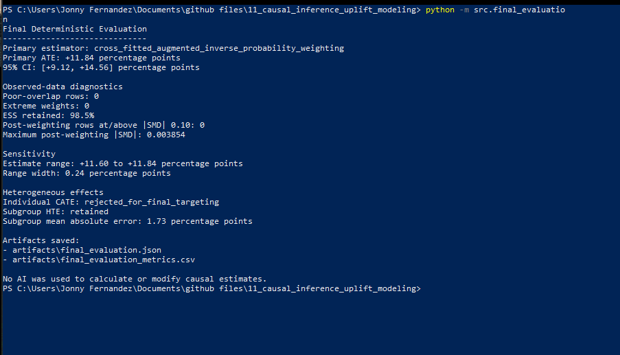
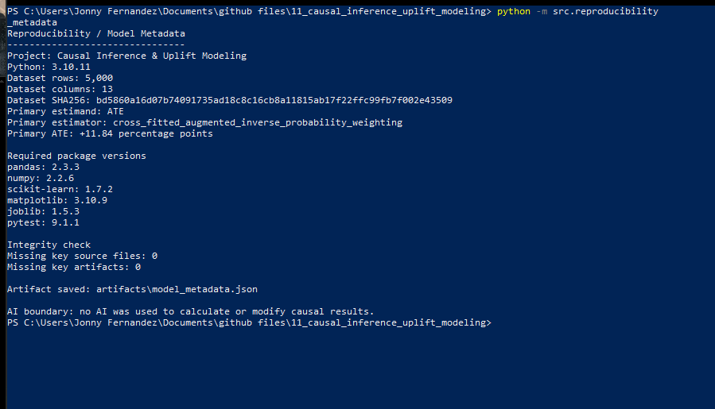
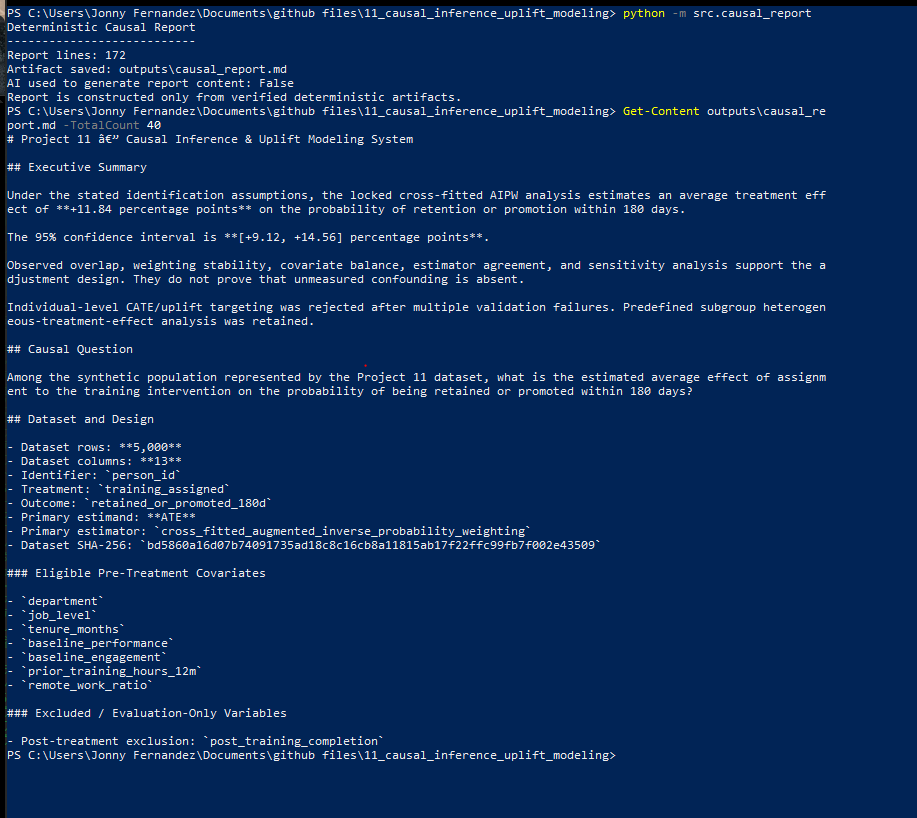
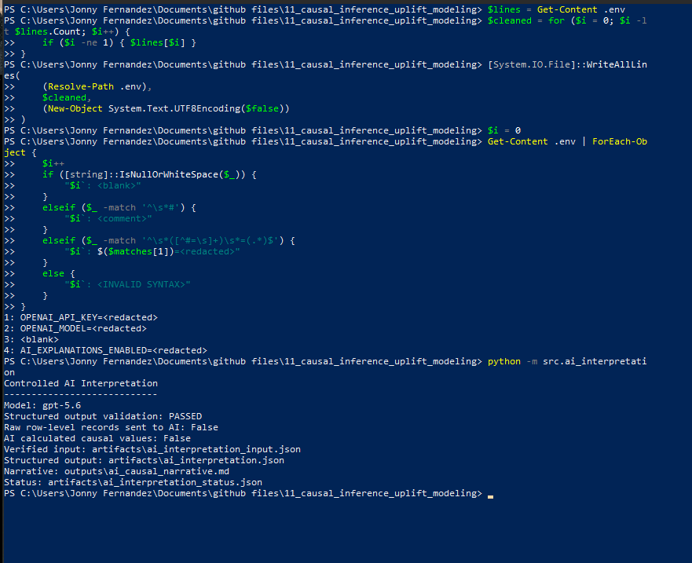
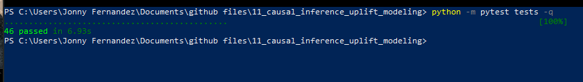
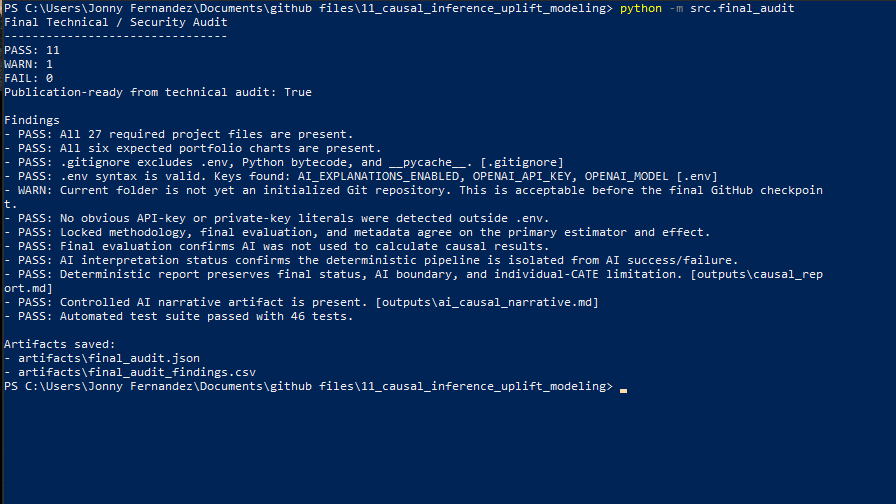

# Project 11 — Causal Inference & Uplift Modeling System

A portfolio-grade causal inference project for estimating the effect of a synthetic training intervention on 180-day retention or promotion outcomes.

The project separates **deterministic causal estimation** from an **optional controlled AI interpretation layer**. All treatment-effect calculations, propensity scores, weighting, balance diagnostics, uncertainty estimates, sensitivity analysis, subgroup effects, and validation metrics are computed deterministically in Python.

## Executive Summary

The locked primary estimator is **cross-fitted Augmented Inverse Probability Weighting (AIPW)**.

| Metric | Result |
|---|---:|
| Naive difference in means | +13.58 pp |
| Stabilized IPW ATE | +11.71 pp |
| AIPW ATE | +11.74 pp |
| **Cross-fitted AIPW ATE** | **+11.84 pp** |
| **95% CI** | **+9.12 to +14.56 pp** |
| Synthetic true ATE | +10.69 pp |
| Error vs. synthetic truth | +1.15 pp |

Observed diagnostics were strong:

- Poor-overlap rows: **0**
- Extreme stabilized weights: **0**
- Effective sample size retained: **98.5%**
- Post-weighting covariates with `|SMD| >= 0.10`: **0**
- Maximum post-weighting `|SMD|`: **0.003854**
- Sensitivity range: **+11.60 to +11.84 pp**
- Full automated test suite: **46 passed**
- Final technical/security audit: **FAIL = 0**

Under the stated identification assumptions, the analysis estimates that assignment to the training intervention increased the probability of retention or promotion within 180 days by approximately **11.84 percentage points**.

This is still conditional on the causal assumptions. Strong observed overlap and covariate balance do **not** prove that unmeasured confounding is absent.

---

## Causal Question

> Among the synthetic population represented in the Project 11 dataset, what is the estimated average effect of assignment to the training intervention on the probability of being retained or promoted within 180 days?

### Treatment

`training_assigned`

### Outcome

`retained_or_promoted_180d`

### Primary Estimand

Average Treatment Effect (**ATE**)

### Locked Primary Estimator

Cross-fitted AIPW

---

## Project Highlights

### Causal design before modeling

The project explicitly separates variables by causal role:

- pre-treatment covariates
- treatment
- outcome
- post-treatment exclusions
- identifiers
- evaluation-only synthetic ground truth

Post-treatment variables are excluded from adjustment to prevent leakage and post-treatment bias.

### Propensity-score workflow

A logistic-regression propensity model is used to estimate treatment probabilities from approved pre-treatment covariates.

Diagnostics include:

- treated/control propensity distributions
- empirical common support
- extreme propensity counts
- stabilized inverse-probability weights
- effective sample size
- trimming/clipping status

### Covariate balance

Balance is measured with standardized mean differences before and after weighting.

Before weighting:

- 2 covariates were at or above the working `|SMD| = 0.10` threshold
- maximum `|SMD| = 0.181117`

After weighting:

- 0 covariates were at or above the threshold
- maximum `|SMD| = 0.003854`

### Doubly robust estimation

The project implements:

1. stabilized IPW
2. AIPW
3. five-fold cross-fitted AIPW

Cross-fitting ensures that each observation's nuisance predictions are produced by models that did not train on that observation.

### Synthetic-truth evaluation

Synthetic truth is used only after estimator construction.

It is **not** used to:

- train the propensity model
- fit the outcome models
- construct IPW/AIPW estimates
- choose the primary estimator because it happens to be closest to truth

It is used only to evaluate estimator recovery.

### Heterogeneous treatment effects

Individual-level CATE modeling was attempted with three defensible approaches:

- Random-Forest DR-Learner
- Regularized DR-Learner
- Interaction S-Learner

All three failed validation for reliable individual treatment-benefit ranking.

The project therefore **rejects individual-level targeting** rather than searching repeatedly for a model that happens to fit the synthetic truth.

Predefined subgroup HTE analysis was retained.

### Sensitivity analysis

The primary conclusion remained highly stable under:

- propensity clipping
- empirical common-support restriction
- stronger logistic regularization
- weaker logistic regularization
- IPW/AIPW/cross-fitted AIPW comparison

The full observed estimate range was only **0.24 percentage points**.

### Controlled AI layer

The optional AI layer:

- receives aggregate verified artifacts only
- receives no raw row-level records
- cannot calculate new causal values
- cannot override deterministic diagnostics
- cannot claim that unmeasured confounding is absent
- cannot recommend individual targeting
- cannot invent a causal mechanism
- is fully isolated from the deterministic pipeline

The causal project remains complete even if the AI layer is disabled or fails.

---

## Key Visuals

### Propensity Score Overlap


The treated and control groups show substantial empirical overlap, supporting the positivity assumption in the observed data.

### Covariate Balance Before and After Weighting


Stabilized ATE weighting substantially reduces observed pre-treatment imbalance.

### Treatment-Effect Estimator Comparison


IPW, AIPW, and cross-fitted AIPW converge on a similar adjusted effect and all adjusted intervals cover the known synthetic ATE.

### Sensitivity Analysis


Reasonable alternate propensity and overlap specifications produce nearly identical ATE estimates.

### Predefined Subgroup Effects


Subgroup analysis is retained as descriptive HTE analysis, with synthetic truth shown only for evaluation.

### Individual CATE Validation Failure


The project documents the failure of attempted individual-level CATE ranking rather than presenting unreliable uplift targeting as a successful result.

---

## Final Screenshots

These screenshots document the final validated project state.

### Final deterministic evaluation



### Reproducibility metadata



### Deterministic causal report



### Controlled AI guardrails



### Automated tests



### Final technical/security audit



---

## Methodology

### Identification assumptions

The causal interpretation requires:

- consistency
- conditional exchangeability / no unmeasured confounding after adjustment
- positivity / overlap
- SUTVA / no interference
- correct treatment timing
- correct outcome timing

These assumptions cannot all be verified from observed data.

### Approved pre-treatment covariates

The propensity and outcome models use approved pre-treatment features such as:

- department
- job level
- tenure
- baseline performance
- baseline engagement
- prior training hours
- remote-work ratio

### Explicit exclusions

The causal pipeline excludes:

- identifier columns
- treatment itself from the covariate set
- outcome from the covariate set
- post-treatment fields
- synthetic truth fields during estimator fitting

---

## Estimator Results

| Estimator | Estimate |
|---|---:|
| Naive difference in means | +13.58 pp |
| Stabilized IPW | +11.71 pp |
| AIPW | +11.74 pp |
| **Cross-fitted AIPW** | **+11.84 pp** |
| Synthetic true ATE | +10.69 pp |

The adjustment reduces the raw treated/control difference, indicating that part of the naive association reflected baseline group differences.

---

## Diagnostics

### Propensity overlap

The fitted propensity scores fall in a healthy empirical range with no observations in the project's extreme-propensity warning regions.

### Weight stability

Stabilized weights are centered near one.

- no clipping
- no trimming
- no overlap restriction
- maximum stabilized weight remained below 2
- effective sample size retained: 98.5%

### Covariate balance

All observed post-weighting covariate SMDs are well below the working threshold.

---

## Uncertainty

The IPW estimator uses a nonparametric bootstrap with propensity-model refitting.

The cross-fitted AIPW estimator uses an influence-function normal approximation.

Locked cross-fitted AIPW result:

**ATE = +11.84 percentage points**

**95% CI = +9.12 to +14.56 percentage points**

---

## Heterogeneous Treatment Effects

### Individual CATE

Individual-level targeting was **rejected**.

Validation showed poor ranking recovery across the attempted CATE methods.

This project does not present Qini or AUUC as successful final metrics.

### Predefined subgroup HTE

Retained subgroup families include:

- department
- job level
- baseline-performance tertile
- baseline-engagement tertile

The subgroup mean absolute error against synthetic truth was approximately **1.73 percentage points**, and all subgroup confidence intervals covered the corresponding synthetic subgroup effects.

Subgroup estimates remain descriptive and should not be interpreted as guaranteed individual outcomes.

---

## Sensitivity Analysis

The primary ATE was highly stable.

| Scenario | Approx. ATE |
|---|---:|
| Empirical common support | +11.60 pp |
| Primary stabilized IPW | +11.71 pp |
| Alternate propensity regularization | ~+11.71 to +11.72 pp |
| AIPW | +11.74 pp |
| Cross-fitted AIPW | +11.84 pp |

Overall range width: **0.24 pp**

---

## AI Governance

AI is optional and interpretive only.

The deterministic pipeline produces the causal result before the AI layer is invoked.

Guardrails require:

- no raw row-level data sent to AI
- no new causal calculations by AI
- no revision of deterministic estimates
- no invented treatment mechanisms
- no claims that diagnostics prove exchangeability
- no individual-targeting recommendations after CATE validation failure

The AI layer writes separate artifacts and cannot invalidate the deterministic causal pipeline.

---

## Testing

The final automated test suite contains **46 passing tests**.

Coverage includes:

- project configuration
- feature-policy enforcement
- post-treatment leakage prevention
- synthetic-truth isolation
- propensity-score validity
- overlap
- weight validity
- effective sample size
- covariate balance
- IPW recalculation
- uncertainty artifacts
- AIPW/IPW agreement
- cross-fitting
- sensitivity stability
- subgroup-size safeguards
- methodology locking
- CATE rejection
- reproducibility metadata
- `.env` protection
- AI aggregate-only inputs
- AI evidence-ID validation
- AI numeric-generation guardrails
- deterministic report integrity

Run:

```powershell
python -m pytest tests -q
```

Expected final result:

```text
46 passed
```

---

## Final Technical / Security Audit

The final audit checks:

- required project files
- all six analytical charts
- `.env` syntax
- `.gitignore` protection
- secret leakage outside `.env`
- methodology consistency
- deterministic/AI separation
- AI failure isolation
- report integrity
- test-suite status

Final result:

```text
PASS: 11
WARN: 1
FAIL: 0
Publication-ready from technical audit: True
```

The single warning is expected before Git initialization.

---

## Reproducibility

The project records:

- dataset SHA-256
- dataset dimensions
- Python version
- package versions
- random seeds
- treatment/outcome definitions
- approved covariates
- post-treatment exclusions
- evaluation-only synthetic truth fields
- model metadata
- source-file hashes
- artifact hashes

Key reproducibility artifact:

```text
artifacts/model_metadata.json
```

---

## Project Structure

```text
11_causal_inference_uplift_modeling/
|
|-- artifacts/
|   |-- aipw_crossfit_scores.csv
|   |-- aipw_crossfit_summary.json
|   |-- aipw_summary.json
|   |-- ate_summary.json
|   |-- balance_diagnostics.csv
|   |-- balance_summary.json
|   |-- final_audit.json
|   |-- final_audit_findings.csv
|   |-- final_evaluation.json
|   |-- final_evaluation_metrics.csv
|   |-- ground_truth_evaluation.json
|   |-- ipw_weights.csv
|   |-- model_metadata.json
|   |-- propensity_diagnostics.json
|   |-- propensity_scores.csv
|   |-- segment_effects.csv
|   |-- segment_effects_summary.json
|   |-- sensitivity_analysis.csv
|   `-- sensitivity_analysis_summary.json
|
|-- config/
|   |-- final_methodology.json
|   `-- project_config.json
|
|-- data/
|   |-- raw/
|   `-- reference/
|
|-- outputs/
|   |-- ai_causal_narrative.md
|   |-- causal_report.md
|   `-- charts/
|       |-- 01_propensity_overlap.png
|       |-- 02_balance_before_after.png
|       |-- 03_estimator_comparison.png
|       |-- 04_sensitivity_analysis.png
|       |-- 05_subgroup_effects.png
|       |-- 06_cate_validation_failure.png
|       `-- chart_manifest.csv
|
|-- screenshots/
|   |-- 01_final_evaluation.png
|   |-- 02_reproducibility_metadata.png
|   |-- 03_deterministic_report.png
|   |-- 04_ai_guardrails_pass.png
|   |-- 05_pytest_46_passed.png
|   |-- 06_final_audit_pass.png
|   `-- .gitkeep
|
|-- src/
|   |-- ai_interpretation.py
|   |-- aipw.py
|   |-- aipw_crossfit.py
|   |-- ate.py
|   |-- balance.py
|   |-- baseline.py
|   |-- cate.py
|   |-- cate_diagnostics.py
|   |-- cate_regularized.py
|   |-- cate_slearner.py
|   |-- causal_report.py
|   |-- data_contract.py
|   |-- failure_analysis.py
|   |-- final_audit.py
|   |-- final_evaluation.py
|   |-- ground_truth_evaluation.py
|   |-- propensity.py
|   |-- reproducibility_metadata.py
|   |-- sensitivity_analysis.py
|   |-- subgroup_effects.py
|   |-- visualizations.py
|   `-- weighting.py
|
|-- tests/
|   |-- test_ai_guardrails.py
|   |-- test_causal_pipeline.py
|   `-- ...
|
|-- .env
|-- .gitignore
`-- README.md
```

---

## Running the Project

The analytical pipeline was developed checkpoint by checkpoint. Key commands include:

```powershell
python -m src.inspect_data
python -m src.baseline
python -m src.propensity
python -m src.balance
python -m src.weighting
python -m src.ate
python -m src.aipw
python -m src.aipw_crossfit
python -m src.ground_truth_evaluation
python -m src.failure_analysis
python -m src.cate
python -m src.cate_diagnostics
python -m src.cate_regularized
python -m src.cate_slearner
python -m src.subgroup_effects
python -m src.sensitivity_analysis
python -m src.final_evaluation
python -m src.reproducibility_metadata
python -m src.causal_report
python -m src.visualizations
python -m pytest tests -q
python -m src.final_audit
```

### Optional controlled AI interpretation

The deterministic causal pipeline does not require the OpenAI API.

If the optional interpretation layer is enabled, configure environment variables in `.env`:

```text
OPENAI_API_KEY=<your key>
OPENAI_MODEL=<supported model>
AI_EXPLANATIONS_ENABLED=true
```

Then run:

```powershell
python -m src.ai_interpretation
```

Never commit `.env`.

---

## Key Artifacts

### Final causal evaluation

```text
artifacts/final_evaluation.json
```

### Reproducibility metadata

```text
artifacts/model_metadata.json
```

### Final methodology lock

```text
config/final_methodology.json
```

### Deterministic causal report

```text
outputs/causal_report.md
```

### Controlled AI narrative

```text
outputs/ai_causal_narrative.md
```

### Final audit

```text
artifacts/final_audit.json
```

---

## Limitations

- The dataset is synthetic and designed for portfolio-safe causal evaluation.
- Conditional exchangeability cannot be proven from observed data.
- Strong balance and overlap do not rule out unmeasured confounding.
- Individual-level CATE/uplift ranking did not validate successfully.
- Predefined subgroup effects should not be interpreted as guaranteed individual outcomes.
- Synthetic ground truth is available because this is a simulation environment; real observational analyses generally do not have this luxury.

---

## Final Project Conclusion

Project 11 demonstrates a complete causal-inference workflow that emphasizes **identification, diagnostics, uncertainty, robustness, honest failure analysis, reproducibility, and AI governance** rather than simply fitting models.

The final locked estimate is a **cross-fitted AIPW ATE of +11.84 percentage points**, with strong overlap, stable weights, excellent observed covariate balance, close estimator agreement, and a narrow sensitivity range.

The project also demonstrates an important negative result: several individual-level treatment-effect models failed to recover reliable uplift ranking. Instead of hiding that failure, the pipeline rejects individual targeting and retains only the better-supported average and predefined subgroup effects.

That combination of successful causal estimation and documented model failure is intentional: the goal is not to produce the most favorable result, but to produce the most defensible one.
